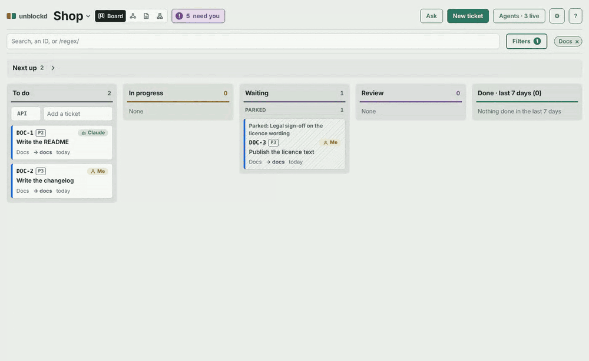
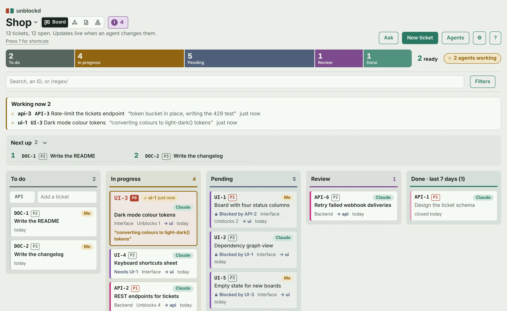
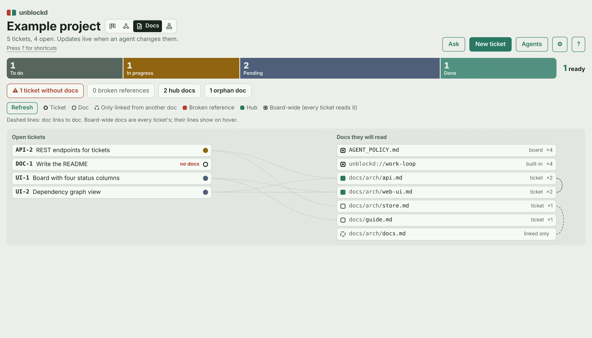
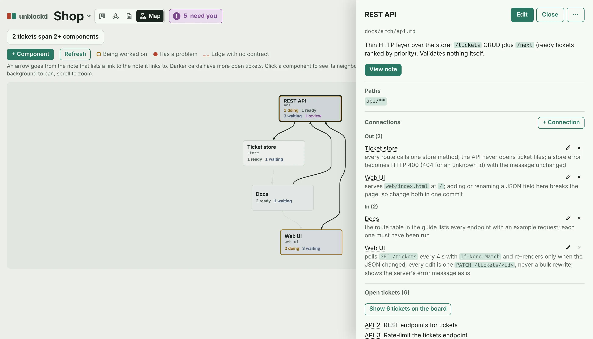

# unblockd

**A ticket board where humans and AI agents work the same backlog.**
Tickets are JSON files in your repo: reviewed in PRs next to the code, no SaaS, no database.



Front doors: web, MCP, CLI, chat (experimental).
Humans get a live board and dependency graph; agents get lease-based claims, so several work in parallel.



**Why not Trello / Linear / GitHub Projects?** Those track work for people. A ticket here knows what blocks it, which files it touches and which docs a worker must read, and an agent claims, heartbeats and finishes it through MCP or a CLI.

<table>
<tr>
<td width="50%"><br><sub>Needs you: answer agents without leaving the board</sub></td>
<td width="50%"><br><sub>Blocking graph</sub></td>
</tr>
<tr>
<td width="50%"><br><sub>Ticket drawer</sub></td>
<td width="50%"><br><sub>Phone width</sub></td>
</tr>
</table>

## Try it in 5 minutes

**1. Run the board** with Docker. `docker compose up -d` (from a clone; `PROJECTS_DIR` in `.env`, default `./example`) serves the board at <http://localhost:8787> and MCP at `http://localhost:8788/mcp`. Board only, no clone (PowerShell: `${PWD}`):

```sh
docker run -d -p 127.0.0.1:8787:8787 -e UNBLOCKD_ALLOW_OPEN=1 -v "$PWD:/projects" ghcr.io/omri2003/unblockd
```

On the board, `g` is the graph, `d` the docs agents read, `j`/`k` step through cards, `?` lists shortcuts.

**2. Connect Claude Code** (one shared server for all your projects):

```sh
claude mcp add --transport http --scope user unblockd http://localhost:8788/mcp
```

With `UNBLOCKD_TOKEN` set add `--header "Authorization: Bearer <token>"`. Each repo's CLAUDE.md names its board (snippet in docs/reference.md). Then tell Claude: *"use unblockd: run work_plan and work all ready tickets."* Watch cards move. An empty claim says why (`dry`, `conflict` = retry, `waiting`; see docs/reference.md). With agent profiles (the demo has `frontend`, `backend`), worker names must be `<profile>-N`, e.g. `backend-1`.

**3. Without Docker** (Python 3.10+; the board and CLI are stdlib only). Run a copy of the demo project, never `example/` itself:

```sh
git clone https://github.com/omri2003/unblockd && cd unblockd
mkdir -p /tmp/demo/shop && cp -r example/tickets /tmp/demo/shop/
UNBLOCKD_ROOT=/tmp/demo python -m unblockd.web
```

Expected: `unblockd on http://localhost:8787  boards: example (...)`. Create a ticket the backend agent can take (press `n`, or):

```sh
python -m unblockd.cli --dir /tmp/demo/shop/tickets create --prefix API --title "My first ticket" --json '{"pillar":"API","owner":"Claude"}'
```

Expected: `"id": "API-3"`, and the card appears within 4 s. For step 2 use one stdio process per client instead:

```sh
pip install mcp
claude mcp add unblockd -e UNBLOCKD_ROOT=/tmp/demo -e PYTHONPATH=$PWD -- python -m unblockd.mcp_server
claude mcp list
```

Expected: `unblockd: python -m unblockd.mcp_server - Connected`. `PYTHONPATH` must be this checkout (not pip-installed).

**In the UI:** a working agent's card says `live · 40 s` or `quiet · 11 min`, with its lease bar. **Waiting** splits by reason: *On you*, *On other work*, *Parked*. The **Needs you** badge (`i`) collects, across all boards, questions, reviews and stuck tickets; answer, approve or *Request changes…* inline. The title switches boards (`Shift+B`). Priorities: P0 breaks things now, P1 must happen, P2 should, P3 nice to have (`p` then `0`-`3`).

## What your agents see


Docs: spot tickets an agent would start blind (no docs, broken links).


Map: an agent on one component gets the contracts of the parts it touches.

## Concepts

| Term | Meaning |
|---|---|
| **Ticket** | One JSON file in `<project>/tickets/`. Status `todo`, `doing`, `review`, `done` (`pending` is derived: a todo with an open blocker or a `waiting_on` question; shown as **Waiting**). |
| **Ready** | Open, nothing open blocks it, not human-owned, not waiting on a person. Agents only claim ready tickets. |
| **Blocked / pending** | Derived: a `todo` with an open `blocked_by` is pending until its blockers are done. |
| **Pillar** | A workstream (UI, API, ...): a colour, filter and graph lane. |
| **Profile** | An agent type in the board config: tags/pillars, model, instructions. `work_plan` groups ready tickets per profile. |
| **Claim, lease, heartbeat** | `claim_next` gives a worker one ticket and sets it to `doing`. With no `heartbeat` for `lease_minutes` (15) the claim expires and the ticket returns to todo. |
| **done_when** | Short acceptance criteria, shown first in the worker's context. |
| **review** | Optional gate (`"review": true`): an agent's `complete` lands in `review`; a human moves it to done. |
| **ask_human / Parked** | A decision only a human can make: the claim ends and the ticket waits in Needs you until you answer. A `waiting_on` you type yourself is *Parked*: never listed there. |

## Configuring agents

Put project rules (tests, commits, when to ask a human) in a doc such as `AGENT_POLICY.md`, listed in `docs` in `unblockd.json`; every worker reads it. The protocol (`WORK_LOOP.md`) is built in; your docs cannot change it. See `example/AGENT_POLICY.md`.

## Config and auth, briefly

| Env var | Meaning |
|---|---|
| `UNBLOCKD_ROOT` | Folder(s) of projects; each `<project>/tickets/unblockd.json` is a board. |
| `HOST`, `PORT` | Bind address (default `127.0.0.1`, `8787`). |
| `UNBLOCKD_TOKEN` | Optional shared token. Set: `/api/*` needs `Authorization: Bearer <token>`, or open `/?token=<token>` once to set a cookie. Unset: no auth, and a non-loopback `HOST` refuses to start unless `UNBLOCKD_ALLOW_OPEN=1` (compose sets it; its ports bind 127.0.0.1 only). Writes must be `application/json`; a foreign `Origin` is refused. The HTTP MCP server (`MCP_PORT`, default `8788`) needs the same Bearer token; stdio MCP and CLI ignore it. |

## More

- [docs/reference.md](docs/reference.md): all env vars, boards, profiles and claims, knowledge docs, chat, `unblockd.json` keys, ticket format, UI features, MCP tools (incl. Docker and Claude Desktop), deploying the image (non-root / OpenShift, `/healthz`, one replica), CLI, REST API, notifications, GitHub PR sync (experimental).
- [AGENTS.md](AGENTS.md): internals and design decisions for contributors.
- [CONTRIBUTING.md](CONTRIBUTING.md), [SECURITY.md](SECURITY.md) (report privately), [CHANGELOG.md](CHANGELOG.md).
- Tests: `python -m unittest`. MIT.
