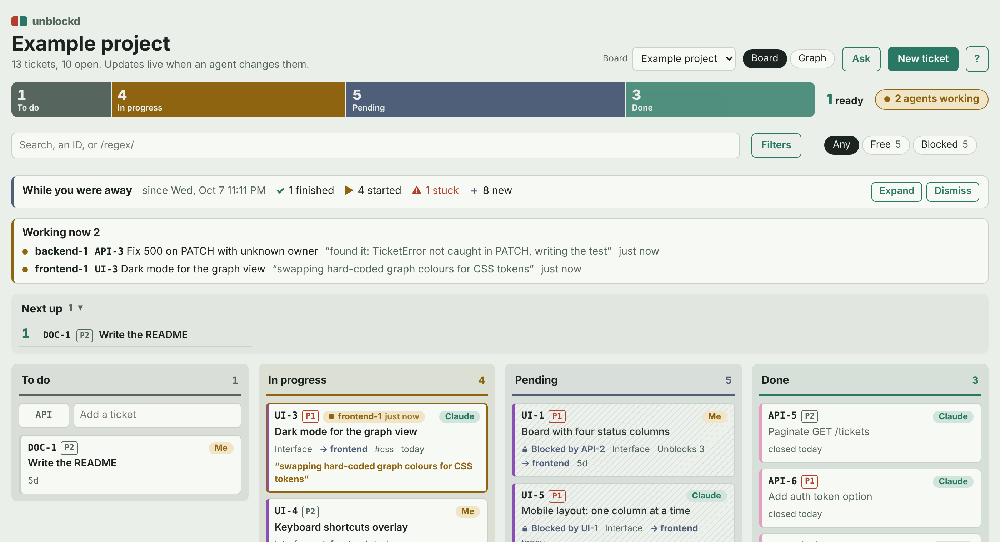
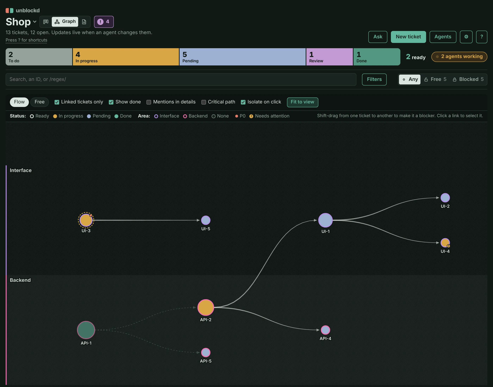
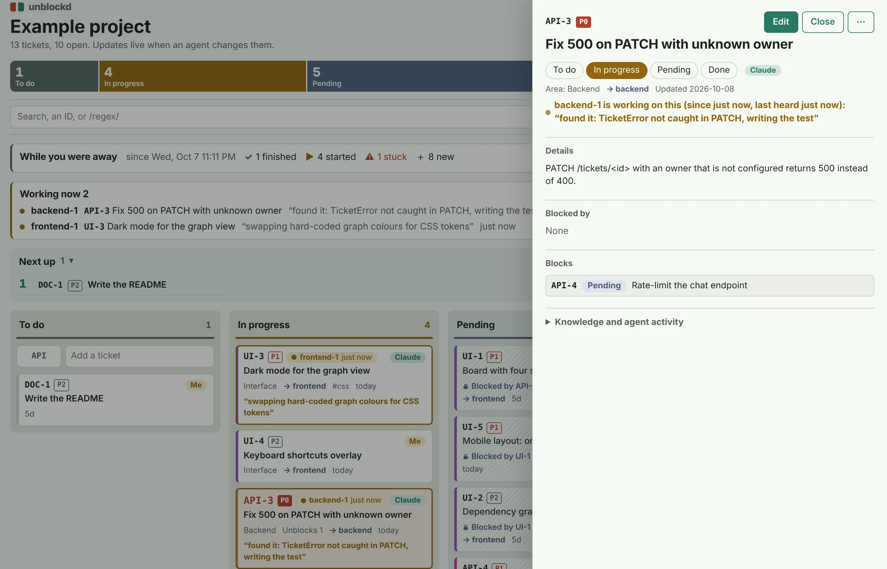
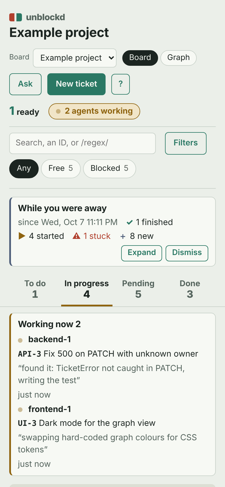

# unblockd



A dependency-aware ticket board for humans and AI agents. **One ticket = one
JSON file** in your repo, so a ticket change is committed with the code it
describes. Three front doors over one core:

| | What | Run |
|---|---|---|
| **Board** | Kanban columns + a blocking graph, live | `python -m unblockd.web` (stdlib only) |
| **MCP server** | Tools for Claude and other MCP agents | `python -m unblockd.mcp_server` (needs `mcp`) |
| **CLI** | The same operations for agents without MCP | `python -m unblockd.cli` |

All three go through `unblockd/store.py`, so they validate and number tickets
the same way and can never disagree.

## Screenshots

<table>
<tr>
<td width="50%"><br><sub>Blocking graph (dark)</sub></td>
<td width="50%"><br><sub>Ticket drawer</sub></td>
</tr>
<tr>
<td colspan="2" align="center"><br><sub>Phone, one column at a time</sub></td>
</tr>
</table>

## Quick start

```sh
git clone https://github.com/omri2003/unblockd && cd unblockd
docker compose up -d --build          # http://localhost:8787, shows ./example
```

Point it at your own projects by putting `PROJECTS_DIR=/path/to/your/projects`
in a `.env` file next to `compose.yaml`. Without Docker (Python 3.10+):
`UNBLOCKD_ROOT=/path/to/your/projects python -m unblockd.web`.

## Boards

One server, many boards. A board is a `tickets/` folder with an
`unblockd.json` in it: every `<project>/tickets/unblockd.json` under
`UNBLOCKD_ROOT` is picked up (the config file is the opt-in, so unrelated
`tickets/` folders are ignored). Switch boards from the header; **New
board…** creates `<root>/<id>/tickets/unblockd.json`. The first board is the
default; the board you last opened is remembered.

| Env var | Meaning |
|---|---|
| `UNBLOCKD_ROOT` | Folder(s) of projects to scan (`:`-separated, `;` on Windows). Needed to create boards. |
| `TICKETS_DIR`, `UNBLOCKD_BOARDS` | Explicit tickets folders, config optional. |
| `UNBLOCKD_TOKEN` | Optional shared token. Set: `/api/*` needs `Authorization: Bearer <token>` or the cookie that opening `/?token=<token>` once sets. Unset: no auth, so keep it on localhost. |
| `UNBLOCKD_LEGACY` | Extra old-backlog files for numbering (see `legacy_files`). |

## Agent profiles: which agent works which ticket

Tickets have `tags`. Agent profiles in `unblockd.json` claim tickets **by tag
or by pillar**; an explicit `agent:<name>` tag overrides both. Each ticket
gets a derived `agent` (shown on its card, filterable in the bar).

```json
"agents": [
  {"name": "godot-dev", "pillars": ["COMBAT"], "tags": ["gdscript"], "model": "sonnet",
   "instructions": "Typed GDScript; run the tests before done."},
  {"name": "blender", "pillars": ["ART"], "instructions": "Batch-process models in Blender."}
]
```

`work_plan` (MCP, `GET .../plan`, CLI `plan`) returns the ready tickets **not
owned by a human**, grouped per profile with its `instructions` and `model`:
everything an orchestrator needs to spawn one agent per group. A single agent
asks `next_ready(agent="godot-dev")` for its own queue.

## Agents at work: claims and the live view

Several agents can work one board at once without stepping on each other.
Each worker uses a unique name (`godot-dev-1`: profile + number) and loops:

```
claim_next(agent)          -> best ready ticket for its profile, set to doing (or null: nothing left)
heartbeat(id, agent, note) -> "what I'm doing now", at least every few minutes
complete(id, agent, summary)   or   release(id, agent, reason)
```

- **Never two on one ticket**: claims take a file lock; tested with six
  workers at once.
- **Never two on the same files**: give tickets `touches` (paths or globs).
  `claim_next` skips a ticket whose `touches` overlap a live claim.
- **Never a human's ticket**: tickets owned by a `kind: human` owner are skipped.
- **Crashed workers don't hold tickets**: a claim with no heartbeat for
  `lease_minutes` (default 15) expires and the ticket goes back to todo.
- Moving a claimed ticket off *doing* by hand ends the claim.
- **Too big? Split it** instead of half-doing it: `split_ticket(id, titles, sequential?)`
  (REST `POST tickets/<id>/split`, CLI `split`, drawer menu *Split…*) makes one child per
  title with the parent's pillar, owner, priority, tags, touches and docs, and the parent
  now waits on all of them (your claim ends); then `claim_next`. *Do in order* chains the parts.

The board shows a **Working now** strip (agent, ticket, last note, how long
ago; *quiet* when it's been silent a while), a pulsing line on claimed cards,
a dashed ring in the graph, and each ticket's **Agent activity** in its
drawer. Claims and the activity log live in `tickets/.unblockd/`, which
ignores itself in git.

**"Work on all tasks you can"**: an orchestrator calls `work_plan`, spawns
one worker per agent profile with that profile's `instructions` and `model`,
and each worker runs the loop above until `claim_next` returns null.

## Knowledge: tickets come with their instructions

Stop re-telling agents what to read. Link docs once and every worker gets
them when it claims a ticket:

| Where | `docs` applies to |
|---|---|
| `unblockd.json` → `"docs"` | every ticket on the board (e.g. `AGENTS.md`, `docs/HANDOFF.md`) |
| an agent profile → `"docs"` | every ticket that profile works (e.g. `docs/MECHANICS.md`) |
| a ticket → `docs` (Edit) | that ticket (e.g. `docs/notes/combat/`) |
| **Attach files** in the drawer | that ticket: stored in `tickets/files/<ID>/`, committed with it |

Entries are repo paths, folders (their text files) or globs; they're links,
so they stay current. `claim_next` / `claim_ticket` return the ticket's
`context`: all of it in that order, deduped, inlined up to `context_budget` (60k characters by default),
with each doc's `links` (markdown links and `@imports`: the knowledge
graph's edges) and an error for anything missing. The drawer's **Knowledge**
list shows the same; click a doc to read it and follow its links. Paths can't
leave the project folder; only text files are read or attached.

## Chat: ask about tickets and boards

**Ask** (or `c`) opens a chat beside the board. Claude answers with read-only
tools over the same data (boards, tickets, `next_ready`, `work_plan`), so it
checks instead of guessing. Link things in a question and they're looked up
before Claude sees it:

| Type | Links |
|---|---|
| `#BUG-10` | a ticket on this board (autocompletes) |
| `#website/UI-2` | a ticket on another board |
| `@website` | a board (its open tickets) |

Answers link back the same way: click a ticket to open it, or another board's
ticket to jump there. Each ticket's drawer has **Ask** to start a question
about it. History stays in your browser, per board.

Needs `ANTHROPIC_API_KEY` in `.env` (compose passes it to the container);
`UNBLOCKD_MODEL` picks the model. Each question is billed to that key and
usually takes a few tool calls. The chat can't change tickets: it tells you
what to change.

## Configure: `tickets/unblockd.json`

Optional. Without it you get two owners (`Me`, `Claude`) and no pillars.

```json
{
  "title": "My game",
  "owners": [{"name": "Dana", "kind": "human"}, {"name": "Claude", "kind": "agent"}],
  "default_owner": "Claude",
  "pillar_label": "Pillar",
  "pillars": [
    {"key": "ART", "name": "Art", "color": "#8A4FB5", "color_dark": "#B58CE6"},
    {"key": "COMBAT", "name": "Combat"}
  ],
  "stale_days": 7,
  "legacy_files": ["../docs/OLD_BACKLOG.md"]
}
```

| Key | Meaning |
|---|---|
| `owners` | Who tickets can belong to. `kind: human` gets the warm chip; new tickets from agents default to the first `agent`. Other names are refused. |
| `pillars` | Workstreams. Each is a board colour, a filter chip and a graph lane. Colours are optional (a palette checked against the status colours is used). With no pillars, any `pillar` value is accepted. |
| `pillar_label` | What your project calls them ("Area", "Track"…). |
| `stale_days` | A `doing` ticket untouched this long is flagged. |
| `wip_limit` | More than this many `doing` tickets shows a WIP badge on the column (default `null` = none). |
| `lease_minutes` | A claim with no heartbeat this long expires (default 15). |
| `legacy_files` | Old ticket lists (relative to the tickets folder): new IDs never reuse a number seen in them. |
| `id` | Board id (default: the project folder's name). |
| `agents` | Agent profiles, see below (each may have its own `docs`). |
| `docs` | Knowledge every ticket on the board comes with, see Knowledge. |
| `context_budget` | Characters of docs inlined per ticket context (default 60000); the rest is listed. |

## Tickets

```json
{"id": "BUG-10", "title": "Search ignores accents", "status": "todo", "priority": "P1",
 "owner": "Claude", "pillar": "COMBAT", "pillar_step": 1, "section": "",
 "blocked_by": ["CMB-4"], "tags": ["gdscript"], "touches": ["scripts/demon_3d.gd"], "waiting_on": "", "body": "cause -> fix -> tests",
 "created": "2026-10-03", "updated": "2026-10-03"}
```

`status` is `todo` · `doing` · `pending` · `done`; a `todo` with an open
blocker *shows* as pending on its own. Create with a prefix (`BUG`) and the
next free number is picked. A `blocked_by` that would make a loop (A waits on
B waits on A) is refused with the loop spelled out.

Every ticket comes back with derived fields: `effective_status`,
`open_blockers`, `blocks`, `unblocks` (open tickets downstream, transitive),
`missing_blockers`, `stale_days`, `agent` and `score` = priority weight
(P0 8, P1 4, P2 2, P3 1) x (1 + `unblocks`).

## The board

- **Next up**: the 5 best ready tickets by score, above the columns.
- **Pillar outlines** on cards, pillar dots on the filter chips.
- **Warnings**: missing blocker, doing with no update for `stale_days`; a *Needs attention* filter.
- **Free / Blocked** filter: *Free* = open, nothing open blocks it, not waiting on a person; *Blocked* = an open ticket blocks it. Counts on the chips; the graph dims the rest.
- **Show: Only / Paths / Dim** (next to the filters, remembered per view): *Only* shows just the tickets the filters match; *Paths* adds every ticket upstream and downstream of a match (the whole chain, not siblings); *Dim* shows everything and fades the rest. Works with every filter, so "owner Omri, Paths" is every chain that touches one of his tickets. Board default is Only, graph default is Dim.
- **Regex search**: wrap the search in slashes, `/^CMB-|BUG-10/`, to match ids and titles (case-insensitive). An invalid pattern turns the box red and matches nothing.
- Drag a card between columns to change its status. Polls every 4 s, so agent edits show up live.

**Graph** (Board / Graph switch): arrow A -> B means A blocks B. Fill =
status, ring = pillar, size = how much is waiting on it.

- **Flow** layout (default): columns = chain depth, rows = pillar lanes,
  crossings reduced by barycenter sweeps. **Free**: force layout.
- Hover = direct links; click = the whole chain and the longest open chain
  to it; **Critical path** toggle; double-click opens the ticket.
- In Only / Paths the graph drops hidden tickets and re-lays out what's left; in Paths, chain-only tickets are drawn faded. Click a ticket, then **Show only this chain** to search its id and switch to Paths. Clear the search to go back.
- **Isolate on click** (toolbar checkbox, on by default): clicking a ticket draws only its whole chain (everything upstream and downstream, over the whole board, ignoring the filters, Show mode and "Linked tickets only") and re-lays it out. **Back to all**, Esc or a click on empty canvas returns to your view, filters untouched. Untick the box for the old highlight-and-dim focus.
- **Shift-drag A onto B** makes A block B; click a link to remove it.
- "Chains as text" under the canvas for screen readers; pinch and wheel zoom.

Keyboard: `/` search, `g` Board/Graph, `n` new, `j`/`k` move, `Enter` open,
`t` theme, `?` shortcuts, `Esc` close. The ⚙ button sets theme (System / Light / Dark), density
(Comfortable / Compact) and the "While you were away" digest, per browser.
**Agents** (header button, or the "N agents working" badge) shows, per agent profile over 7 or 30 days, tickets finished, median time to finish, stuck rate (expired + released claims, flagged at 30% or more), splits and who is working now.

## Connect the MCP server

**Claude Code:**

```sh
claude mcp add unblockd --scope user -- docker run -i --rm -v /path/to/projects:/projects unblockd python -m unblockd.mcp_server
```

**Claude Desktop** (`claude_desktop_config.json`):

```json
{"mcpServers": {"unblockd": {"command": "docker",
  "args": ["run", "-i", "--rm", "-v", "/path/to/projects:/projects", "unblockd", "python", "-m", "unblockd.mcp_server"]}}}
```

Build the image once first (`docker compose build`), or use
`ghcr.io/omri2003/unblockd` in place of `unblockd`.

Tools: `list_boards`, `create_board`, `board_info` (owners, pillars, agent
profiles), `work_plan` (orchestrators start here), `next_ready` (single agents
start here; `agent=`, `tag=`), `list_tickets`, `get_ticket`, `create_ticket`,
`update_ticket`, `split_ticket`, `delete_ticket`; for workers `claim_next`, `claim_ticket`,
`heartbeat`, `release`, `complete`, `agents_now`; for knowledge `get_context`,
`read_doc`, `attach_file`, `detach_file`. Every tool takes `board=`
(default: the first board).

## CLI

```
python -m unblockd.cli --dir <repo>/tickets next --owner Claude --agent godot-dev
python -m unblockd.cli --dir <repo>/tickets plan --per-agent 3
python -m unblockd.cli --dir <repo>/tickets claim --agent godot-dev-1
python -m unblockd.cli --dir <repo>/tickets heartbeat BUG-10 --agent godot-dev-1 --note "running tests"
python -m unblockd.cli --dir <repo>/tickets complete BUG-10 --agent godot-dev-1 --summary "cause -> fix -> tests"
python -m unblockd.cli --dir <repo>/tickets list --status todo
python -m unblockd.cli --dir <repo>/tickets get BUG-10
python -m unblockd.cli --dir <repo>/tickets create --prefix BUG --title "..." --json '{"priority":"P1"}'
python -m unblockd.cli --dir <repo>/tickets split BUG-10 --title "part one" --title "part two" --sequential
python -m unblockd.cli --dir <repo>/tickets update BUG-10 --json '{"status":"done"}'
python -m unblockd.cli --dir <repo>/tickets note BUG-10 "dated finding appended to the body"
```

## API

```
GET    /api/boards                    every board with ticket counts
GET    /api/chat                      {"enabled", "model"}
POST   /api/chat                      {"board", "messages": [{"role", "content"}]} -> {"reply", "tools", "refs"}
POST   /api/boards                    {"id": "my-game", "title": "My game"}
# per board under /api/b/<board>/ ; without the prefix = the default board
GET    meta                           statuses, priorities, fields, config
GET    tickets?status=&pillar=&owner=&priority=&tag=&agent=&q=
GET    next?owner=&pillar=&agent=&tag=&limit=
GET    plan?per_agent=
GET    agents                         who is working what now + recent activity
GET    activity?ticket=&limit=
POST   claim                          {"agent", "profile"?, "note"?}
POST   tickets/<id>/claim|heartbeat|release|complete   {"agent", "note" | "reason" | "summary"}
GET    tickets/<id>/context?inline=0  docs + attached files to read before working it
GET    doc?path=                      a text file from the project repo, with its links
POST   tickets/<id>/files             {"name", "content"}     GET / DELETE tickets/<id>/files/<name>
GET    tickets/<id>
POST   tickets                        {"prefix": "BUG", "title": "...", ...}
PATCH  tickets/<id>                   {"status": "done"}
DELETE tickets/<id>
```

**No auth.** It listens on 127.0.0.1; don't expose the port wider.

## Develop

- New ticket field: one line in `FIELDS` in `store.py`; show it in `static/index.html`.
- New MCP tool: a function with `@tool` in `mcp_server.py` calling `Store`.
- New API route: a branch in `Handler._route` in `web.py`.

Tests: `python -m unittest`. UI changes show on a browser reload; Python
changes after `docker compose restart`.

## License

MIT
